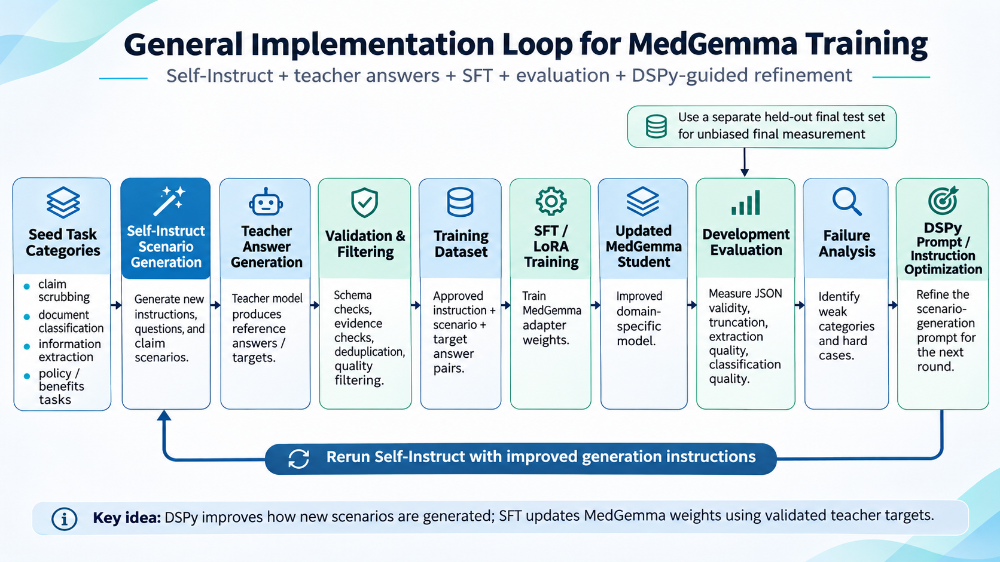

#Chatgpt-luna and qwen3 based distillation loop implementation
##Purpose
The purpose of this is to fine-tune qwen3-8B using LLM(gpt6-luna) using a distillation approach. It will be implemented in a way where minimal human interaction is required as many tools will be used to distill qwen until the desired results are required.
##Tools/Approaches
- DSPY: for trained adapter evaluation and next prompt generation
- LightEval: benchmarking the trained adapters
- Self-Instruct: self-instruct will allow the training loop to generate prompts and scenarios upon which the model can be trained on. It is a methodology and not a tool.
- SFTTrainer: Will be used for loss calculation and back-propegation
##Implementation overview

